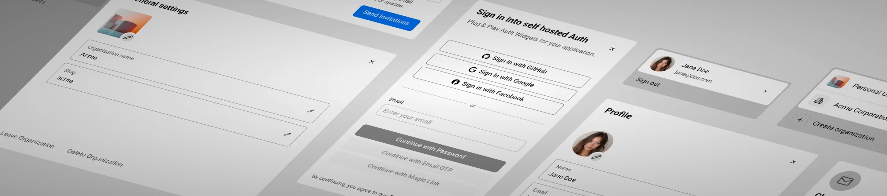
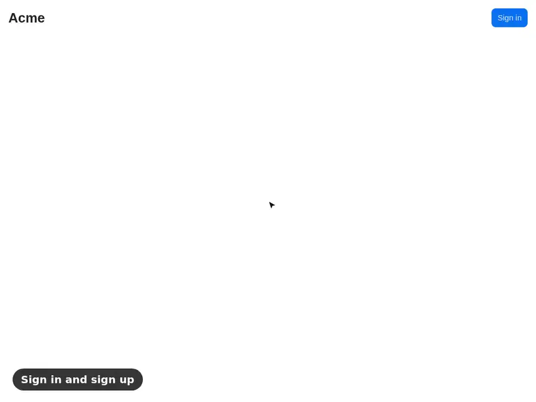

  <picture>
    <source srcset="../bannerDark.webp" media="(prefers-color-scheme: dark)">
    <source srcset="../banner.webp" media="(prefers-color-scheme: light)">
    
  </picture>

<h2 align="center">Convex Better Auth UI for Next.js</h2>

  Sign-in, user profiles, organizations and an admin dashboard for Next.js apps on Convex and Better Auth, copied into your repository.
    
  <a href="https://etesie.com/docs/auth/overview/introduction"><strong>Documentation</strong></a>
  ·
  <a href="https://github.com/mmailaender/Convex-Better-Auth-UI/issues">Issues</a>

  <picture>
    <source srcset="../showcaseDark.webp" media="(prefers-color-scheme: dark)">
    <source srcset="../showcase.webp" media="(prefers-color-scheme: light)">
    
  </picture>

Auth UI is the sign-in, user profile, organization and admin UI for Next.js apps that run on [Convex](https://convex.dev) and [Better Auth](https://www.better-auth.com). The [jsrepo](https://jsrepo.dev) CLI copies the components, routes and Convex functions into your repository, shadcn-style, so they're your code from the first commit. There's no hosted auth service: users, sessions and organizations live in your own Convex deployment.

## Get started

[Install Auth UI in Next.js](https://etesie.com/docs/auth/getting-started/nextjs) creates the app, connects it to Convex and adds `@auth/nextjs` with `jsrepo add`. Auth UI also ships for SvelteKit: see the [repository README](https://github.com/mmailaender/Convex-Better-Auth-UI#readme).

## What ships

Each feature is a flag in `src/convex/auth.constants.ts`. The default install turns on password sign-in only.

| Feature              | What you get                                                                                                                            |
| -------------------- | --------------------------------------------------------------------------------------------------------------------------------------- |
| Sign-in              | One email-first form for sign-in and sign-up, with password, email verification code (OTP), magic link and 27 social providers.         |
| User profile         | A user button and a profile dialog: name and avatar, email change, linked accounts, set or change password, delete account.             |
| Organizations        | Organization switcher, create organization, organization profile with members, email invitations and the roles owner, admin and member. |
| API keys             | Users create and delete their own API keys in the profile dialog.                                                                       |
| Device authorization | Better Auth's device flow, for signing in a CLI or another device without a browser.                                                    |
| Admin dashboard      | `/admin` to search, create, ban, impersonate and delete users, and to manage every organization and its members.                        |
| Emails               | Verification, password reset, sign-in codes, magic links, email change and invitations, sent through Resend.                            |

[Features](https://etesie.com/docs/auth/features) covers each one and the flags that turn it on.

## What you take on

The components are files in your repository, so you can change any of them. Updates arrive the way vendored code does: `jsrepo update <item>` shows the diff for each file, and you merge it with your own edits.

The runtime dependencies stay ordinary packages in your `package.json`: Convex, Better Auth, `@convex-dev/better-auth`, Skeleton and Ark UI. Nothing bills you per user: you pay for your Convex usage and, if you send email, Resend.

[Why Auth UI](https://etesie.com/docs/auth/overview/why-auth) makes the case for owning your auth code, and [Comparison](https://etesie.com/docs/auth/overview/comparison) sets Auth UI against Better Auth UI.

## This folder

This folder is the `@auth/nextjs` registry and the Next.js app it's built from. The Convex functions it deploys live in [`../shared/convex/`](../shared/convex). Release notes go through [changesets](../.changeset/README.md).
